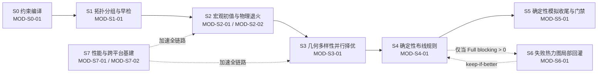

# AI4PCB × KiCadRoutingTools 结构化长效工程改进手册 (Living Playbook)

| 元数据项 | 值 |
| :--- | :--- |
| **文档版本** | `v1.0`（结构化标准版，与 [`playbook_registry.yaml`](./playbook_registry.yaml) 严格 1:1 同步） |
| **适用仓库与分支** | `Tools/KiCadRoutingTools` · `ai4pcb/main`（基于上游 `drandyhaas/KiCadRoutingTools @ 61565f3`） |
| **最后更新** | `2026-11-25` |
| **状态枚举** | `VERIFIED`（已实现+单测+配对实测） · `CONDITIONAL`（有严格触发前提） · `DIAGNOSED_BACKLOG`（已定位根因待实施） · `PLANNED`（路线图） |

---

## 1. 端到端链路拓扑与改造锚点图（Stage 0 → Stage 7）



---

## 2. 全链路改造点总索引矩阵（Master Index）

| ID | 阶段 | 改造点名称 | 状态 | 优先级 | 核心代码锚点 | 实测核心收益 |
| :--- | :---: | :--- | :---: | :---: | :--- | :--- |
| **`MOD-S0-01`** | S0 | 路线 B `board.yaml` 约束编译器 + 禁正则差分误报 | `VERIFIED` | `P0` | `py_tools/compile_board_constraints.py`<br/>`py_placer/judge_seeds.py` | 漏网电源/机壳 **`3 → 0`**；自动推导 `dy=40mm` 对称与 8 发热阻 |
| **`MOD-S1-01`** | S1 | 契约预校验 + 原生早检 Courtyard DRC | `VERIFIED` | `P1` | `py_tools/ai4pcb_harness.py` | `<2 s/seed` 拦截封装碰撞（Exp03 18/18 零碰撞） |
| **`MOD-S2-01`** | S2 | 增量硬对称 + 自定义热隔离 + 耦合对称移动 | `VERIFIED` | `P0` | `py_placer/placement/simple.py`<br/>`py_placer/placement/simple_anneal.py` | 41 对 X/Y 误差 **`22.89 → 0.00 mm`**；旋转错 **`25 → 0`**；热阻-IC **`+48.8%`** |
| **`MOD-S2-02`** | S2 | 宏观信号流解析初值 + 有界局部退火 | `CONDITIONAL` | `P1` | `py_placer/placement/simple_anneal.py`<br/>`py_placer/place_simple.py` | 种子代价标准差 **`-61.6%`**；**边界**：全局摆件勿锁紧 `R=18mm` |
| **`MOD-S3-01`** | S3 | 自适应几何多样性（`--diverse auto`）+ `--confirm close` | `VERIFIED` | `P0` | `py_placer/placement/diversity.py`<br/>`py_placer/judge_seeds.py`<br/>`py_tools/ai4pcb_harness.py` | 3 板 × 2 预算 **6/6 胜或持平**；`k=4` Top-6 命中 **`3.0×`**；3/3 板反转 |
| **`MOD-S4-01`** | S4 | 同网 SMD 焊盘避让（`0.25–0.30 mm`）+ `0.22 mm` 裕量 | `VERIFIED` | `P0` | `py_tools/compile_board_constraints.py`<br/>`py_router/route.py` | 非 EP `via_in_smd` **`50 → 0`**；`<0.30mm` 擦边 **`73 → 1` (-98.6%)** |
| **`MOD-S5-01`** | S5 | 确定性模拟收尾原语 + Pass-2 手术刀 DRC 自愈 | `VERIFIED` | `P0` | `py_tools/analog_finish.py` | B01 DFM 缺陷 **`5/5 → 0/5`**；`bad_therm=0`、`perim=30`、耗时 `23.7 s` |
| **`MOD-S6-01`** | S6 | 布线失败/拥堵热力图局部回灌 + `keep-if-better` 门禁 | `CONDITIONAL` | `P1` | `py_placer/placement/route_feedback.py`<br/>`py_tools/ai4pcb_harness.py` | L2 阻断 `4 → 3`；**边界**：仅在全量 `blocking > 0` 时触发 |
| **`MOD-S7-01`** | S7 | `heights.py` 3D GLB 0° 规范栅格缓存 + 文件锁 | `DIAGNOSED_BACKLOG` | `P0` | `py_placer/placement/heights.py` | 预计 18-Seed 3D 高度检测从 **`13 min → <45 s` (5×–10×)** |
| **`MOD-S7-02`** | S7 | Windows `pythonw.exe` / `conhost.exe` 窗口饥饿修复 | `VERIFIED` | `P0` | `ai4pcb_harness.py`, `place_simple.py`, `judge_seeds.py`, `heights.py` | 彻底消除 2.7 MB / 0% CPU 挂死，子进程 `<3 s` 稳定完成 |

---

## 3. 故障症状 → 改造点速查矩阵（Troubleshooting Lookup）

| 观察到的失效症状 | 对应改造点 ID | 立即执行动作 / 参数 |
| :--- | :---: | :--- |
| 非 EP 贴片焊盘被过孔砸中（`via_in_smd > 0`）或 `<0.30 mm` 擦边 | `MOD-S4-01`, `MOD-S5-01` | 布线传 `--same-net-pad-clearance 0.30`；收尾走 `analog_finish.py --same-net-smd-clearance 0.25` |
| 细间距 IC 报 `starved_thermal`，但改整板覆铜会毁掉 0603 热焊盘 | `MOD-S5-01` | 直接跑 `analog_finish.py`（外层强制 `THERMAL` + Pass-2 仅对单引脚局部修复） |
| 覆铜后出现零星孤立 SMD 地焊盘未连接或浮铜孤岛 | `MOD-S5-01` | 使用 `analog_finish.py` v2（自动开启 `ISLAND_REMOVAL_MODE_ALWAYS` + Pass-2 自动补安全地孔/短引线） |
| 路由报 `0.1905–0.1977 mm` 亚 10µm 异网间距违例 | `MOD-S4-01` | 设 `--clearance` 比 fab 规则高 `0.02 mm`（如 `0.20 mm` 板设 `--clearance 0.22`） |
| 精密双通道板 X/Y 器件不对称、发热功率电阻贴近运放 | `MOD-S0-01`, `MOD-S2-01` | 先跑 `compile_board_constraints.py` 生成约束并填入 `symmetry_pairs`，再跑 `place_simple.py --constraints-json` |
| 多 Seed 布局彼此雷同，或代理代价第 1 名实际布线反而很差 | `MOD-S3-01` | 至少生成 `12–18` 颗候选，启用 `--diverse auto --judge 6` + `judge_seeds.py --confirm close` |
| 紧预设分区（`blocks`）板上 `farthest` 选到角落高代价离群点 | `MOD-S3-01` | 改用 `--diverse auto`（`p90_ic_mm < 10.5 mm` 自动切 `medoid@1.10`） |
| 强物理约束下不同 Seed 代理代价方差过大 | `MOD-S2-02` | 加 `--macro-flow` 温启动（全局首摆**不要**搭配过紧 `--local-radius`） |
| 电源轨或 `/CHASSIS` 漏加宽；`/V_GP` 与 `/V_GN` 触发伪差分对告警 | `MOD-S0-01` | 用 `compile_board_constraints.py` 编译 `board.yaml` + `judge_seeds.py --no-diff-pair-warn` |
| 全量布线仍有 `blocking > 0` 断线，但不愿推翻整板 | `MOD-S6-01` | 跑 `ai4pcb_harness.py feedback-refine`（内置 `keep-if-better` 防退化） |
| Windows 多进程下 `quick_score` / `kicad-cli` 卡在 `2.7 MB` / `0% CPU` | `MOD-S7-02`, `MOD-S7-01` | 子进程加 `CREATE_NO_WINDOW`；避免大量进程同时触发冷缓存 3D GLB 导出 |

---

## 4. 标准化改造点档案卡（Modification Cards）

> **卡片规范**：每张卡片固定包含 9 个结构化字段，便于人工查阅与脚本自动校验。

---

### `MOD-S0-01` · 路线 B `board.yaml` 确定性约束编译器

| 字段 | 内容 |
| :--- | :--- |
| **Stage & Status** | `S0 约束编译` · **`VERIFIED`** · 优先级 `P0` · 风险 `LOW` |
| **Pipeline Handoff** | `board.yaml` + `fixed.kicad_pcb` → `routing_policy.json` + `compiled_constraints.json` + `judge_chain.txt` |
| **Code Anchors** | [`py_tools/compile_board_constraints.py`](../py_tools/compile_board_constraints.py) (`compile_constraints`, `render_judge_chain`, `_infer_symmetry_from_connectors`)；[`py_placer/judge_seeds.py`](../py_placer/judge_seeds.py) (`--no-diff-pair-warn`) |
| **Baseline Failure** | LLM 手工抄写规则在 B01 上遗漏 `/CHASSIS`（退化为 `0.20 mm`）和 `/VCC_DUT`/`/VEE_DUT`（`0.40 mm`）；KRT 正则误将 `/V_GP` & `/V_GN` 判为差分对；悬空单焊盘 `unconnected-*` 混入布线链。 |
| **Mechanism** | 确定性解析 `power_rails`、接口契约 `*CHASSIS*` 与下游保护轨，剔除参考地平面与 `unconnected-*`；自动从成对锁定连接器反推 `dx/dy` 平移向量；自动提取 2512 功率电阻与精密 IC 清单；显式设置 `forbid_regex_diff_pairs` 和 `same_net_pad_clearance_mm`。 |
| **Activation / Rollback** | **启用**：`compile_board_constraints.py <board.yaml> <pcb> --out-dir <dir> --same-net-pad-clearance 0.30`；**回退**：省略 `--board-yaml`，手写 `chain.txt`。 |
| **Paired A/B Evidence** | `EXP-02`：5 条电源/防护网 0 漏项（`/+15V`/`/-15V=0.75–0.80 mm`、`/CHASSIS=0.80 mm`、`/VCC_DUT`/`/VEE_DUT=0.65–0.75 mm`）；自动识别 `dy=40.0 mm` 与 `R12–R19` 发热组；伪差分告警 `1 → 0`。 |
| **Boundaries** | 要求工程提供 GongLab 路线 B 规范 `board.yaml`；非 GongLab 外部板自动跳过编译步。 |
| **Regression Gate** | `python tests/test_ai4pcb_constraints_and_harness.py` |

---

### `MOD-S1-01` · 契约预校验与原生早检 Courtyard DRC 门禁

| 字段 | 内容 |
| :--- | :--- |
| **Stage & Status** | `S1 分组与早检` · **`VERIFIED`** · 优先级 `P1` · 风险 `LOW` |
| **Pipeline Handoff** | `groups.json` + `intent.json` + `s{seed}.kicad_pcb` → `early_courtyard_drc` 报告 |
| **Code Anchors** | [`py_tools/ai4pcb_harness.py`](../py_tools/ai4pcb_harness.py) (`cmd_place`, `_early_courtyard_check`) |
| **Baseline Failure** | 分组漏件/语法错等到多核退火后才失败；封装原生 courtyard 重叠等到完整布线 + 覆铜 DRC 时才暴露。 |
| **Mechanism** | `place` 阶段前置运行 `check_groups.py` 与 `check_floorplan.py`；退火出图后立即对入围多样性种子跑不覆铜的 `kicad-cli pcb drc --format json`（`<2 s/seed`），只提取 `courtyard_overlap` 与板边违例。 |
| **Activation / Rollback** | **启用**：`ai4pcb_harness.py place` 默认开启；**回退**：`--skip-validate` / `--no-check-courtyard`。 |
| **Paired A/B Evidence** | `EXP-03`：18 颗新布局种子全部在 `<2 s/seed` 内完成原生 KiCad 10 courtyard 校验（`0/18` 冲突），无需等待 5–10 min 全布线。 |
| **Boundaries** | 不执行覆铜与电气连通检查，不可替代 Stage 5 全量 DRC。 |
| **Regression Gate** | `ai4pcb_harness.py place` 端到端集成测试（`EXP-05`）。 |

---

### `MOD-S2-01` · 增量硬物理约束（精确平移对称 + 自定义热隔离）与耦合对称移动

| 字段 | 内容 |
| :--- | :--- |
| **Stage & Status** | `S2 宏观与物理退火` · **`VERIFIED`** · 优先级 `P0` · 风险 `LOW` |
| **Pipeline Handoff** | `fixed.kicad_pcb` + `physics_constraints.json` → 严格对称且热隔离的 `s{seed}.kicad_pcb` |
| **Code Anchors** | [`py_placer/placement/simple.py`](../py_placer/placement/simple.py) (`_hint_value`, `_hint_full`, `_hint_local`)；[`py_placer/placement/simple_anneal.py`](../py_placer/placement/simple_anneal.py)（耦合对称移动算子）；[`py_placer/place_simple.py`](../py_placer/place_simple.py) (`--constraints-json`) |
| **Baseline Failure** | 上游退火无对称项与自定义最小热距项；B01 无框基线（`Arm B0`）41 对 X/Y 通道均值失配 **`22.89 mm`**（最大 `74.31 mm`）、朝向失配 **`25/41`**，2512 功率电阻距精密 IC 均值仅 `16.24 mm`。 |
| **Mechanism** | 在 `simple.py` 增量目标引擎中实现 `symmetry`（平移+旋转误差）与 `apart_min`（任意 `min_mm` 排斥）；退火移动算子以 75% 概率同步平移/旋转配对器件、25% 概率允许单件合法化微调。 |
| **Activation / Rollback** | **启用**：`place_simple.py ... --constraints-json <file>`；**回退**：省略 `--constraints-json`。 |
| **Paired A/B Evidence** | `EXP-03`（6-Seed 均值，`B0` → `B1`）：41 对平移误差 **`22.89 → 0.00 mm`**（最大 `74.31 → 0.00 mm`）；朝向错乱 **`25.0 → 0.0/41`**；热阻-IC 间距 **`16.24 → 24.17 mm` (+48.8%)**；热阻互距 **`5.62 → 11.12 mm` (+97.9%)**；L2 零阻断种子数 **`0/4 → 2/4`**。 |
| **Boundaries** | `symmetry_pairs` 须保证左右通道器件一一对应且目标平移向量在板框内合法；无须再手写坐标框（`blocks: []`）。 |
| **Regression Gate** | `python tests/test_ai4pcb_physics_and_feedback.py`（校验 `local() == total()` 误差 `< 1e-5`）。 |

---

### `MOD-S2-02` · 宏观信号流解析初值（`--macro-flow`）与有界局部退火（`--local-radius`）

| 字段 | 内容 |
| :--- | :--- |
| **Stage & Status** | `S2 宏观与物理退火` · **`CONDITIONAL`** · 优先级 `P1` · 风险 `MEDIUM` |
| **Pipeline Handoff** | `fixed.kicad_pcb` → 低方差初始位姿 → 有界局部退火 `s{seed}.kicad_pcb` |
| **Code Anchors** | [`py_placer/placement/simple_anneal.py`](../py_placer/placement/simple_anneal.py)；[`py_placer/place_simple.py`](../py_placer/place_simple.py) (`--macro-flow`, `--keep-poses`, `--local-radius`, `--movable-only`) |
| **Baseline Failure** | 强物理约束下纯随机初值易落入高代价局部谷底（`Arm B1` 6 种子代理代价 `1277–1762`，标准差 `161.2`，跨度 `484.8`）。 |
| **Mechanism** | 基于锁定连接器与网表连接关系生成低抖动二次信号流初值并预先对齐对称对中点；`--local-radius` 将单件移动半径限制在初始位姿 `R` mm 以内，`--movable-only` 允许仅微调热点子集。 |
| **Activation / Rollback** | **启用**：`--macro-flow`（全局温启动）或 `--keep-poses --local-radius 8.0 --movable-only ...`（局部精修）；**回退**：省略参数。 |
| **Paired A/B Evidence** | `EXP-03`（`B1` → `B2`）：6 种子代理代价均值 `1490.0 → 1429.1`（`-4.1%`），标准差 **`161.2 → 61.9` (-61.6%)**，跨度 **`484.8 → 189.6` (-60.9%)**，仍保持 `0.00 mm` 对称与全量 `0 blocking`；**但** `R=18 mm` 过紧导致 L2 阻断升高（`4–7` vs `B1` 的 `0–6`）。 |
| **Boundaries** | **重要适用边界**：首次全局布局用 `--macro-flow` 时**不要加过紧 `--local-radius`**（不限制或设 `R >= 35 mm`）；紧半径 `R = 6–12 mm` 专用于 Stage 6 局部微调。 |
| **Regression Gate** | `python tests/test_ai4pcb_physics_and_feedback.py` |

---

### `MOD-S3-01` · 自适应几何多样性并行择优（`--diverse auto`）与两级全量确认

| 字段 | 内容 |
| :--- | :--- |
| **Stage & Status** | `S3 多样性并行择优` · **`VERIFIED`** · 优先级 `P0` · 风险 `LOW` |
| **Pipeline Handoff** | `N` 颗合法布局（`12–18` 颗） → `K` 颗异构拓扑代表（`4–6` 颗） → 并行 L2 快布 → 接近带并行全量确认冠军 |
| **Code Anchors** | [`py_placer/placement/diversity.py`](../py_placer/placement/diversity.py)；[`py_placer/place_simple.py`](../py_placer/place_simple.py) (`--diverse auto`)；[`py_placer/judge_seeds.py`](../py_placer/judge_seeds.py) (`--diverse`, `--confirm close`)；[`py_tools/ai4pcb_harness.py`](../py_tools/ai4pcb_harness.py) (`cmd_judge`) |
| **Baseline Failure** | `pcb_agent_harness.py` 阉割为单选 `judged_list[0]`；上游 `final.cost[:k]` 扎堆同一局部盆地漏掉全量冠军；单一 `farthest` 在紧预设分区板（`B01_Zoned`）易挑到小框边缘离群点。 |
| **Mechanism** | 宏引脚加权位姿距离（自动剔除锁定/静止件）+ 缺陷层级隔离 + 0 号最低代价槽永久保底；`auto` 依据池内 90 分位宏 IC 间距 `p90_ic_mm` 自动路由：`< 10.5 mm` 用 `medoid@1.10`，`>= 10.5 mm` 用 `farthest@1.20`；Harness 强制 `--confirm close` 并在仅 1 颗接近时自动补跑 `--full`，绝不交付 `--quick 2` 板。 |
| **Activation / Rollback** | **启用**：`place_simple.py --judge 6 --diverse auto` + `judge_seeds.py --confirm close --jobs 6`；**回退**：`--diverse off`。 |
| **Paired A/B Evidence** | `EXP-01`（3 板 × 全 18-Seed Oracle）：**6/6 组合全胜或持平基线**；Top-6 Oracle 命中率 **`k=4: 16.7% → 50.0% (3.0×)`**、**`k=6: 27.8% → 50.0% (1.8×)`**；在 `B01_Free (k=6)` 与 `Splitflap (k=4)` 上命中了被纯代价法漏掉的全局全量冠军；3/3 板 100% 验证 `--confirm close` 排名反转。 |
| **Boundaries** | 需配置候选池至少为 `2×–3×` 试布预算（如 `12–18` 颗选 `4–6` 颗），若候选数 `<= k` 则自动退化为全选。 |
| **Regression Gate** | `python tests/test_ai4pcb_geometric_diversity.py` + `tests/test_1327_judge_seeds.py` + `tests/test_1645_judge_clean_seeds.py` |

---

### `MOD-S4-01` · 同网 SMD 焊盘过孔避让与 `0.02 mm` 路由间距裕量

| 字段 | 内容 |
| :--- | :--- |
| **Stage & Status** | `S4 确定性布线规则` · **`VERIFIED`** · 优先级 `P0` · 风险 `LOW` |
| **Pipeline Handoff** | `s{best}.kicad_pcb` + `routing_policy.json` → 零 via-in-SMD、足宽电源/机壳线 `routed.kicad_pcb` |
| **Code Anchors** | [`py_tools/compile_board_constraints.py`](../py_tools/compile_board_constraints.py) (`default_same_net_pad_clearance_mm`, `default_clearance_mm=0.22`)；[`py_router/route.py`](../py_router/route.py) |
| **Baseline Failure** | KRT 默认 `SAME_NET_PAD_CLEARANCE = -1.0` 在 B01 产生 50 处非 EP via-in-SMD 和 73 处擦边；`--clearance 0.21` 贴近 `0.20 mm` fab 规则时，0.1 mm 路由网格斜线离散化偶发 `0.1905–0.1977 mm` 违例。 |
| **Mechanism** | 启用 `--same-net-pad-clearance 0.25–0.30` 禁止过孔落入非 EP 贴片焊盘；默认路由间距提升至 `fab_clearance + 0.02 mm`（`0.22 mm`）吸收网格离散误差；显式传入编译态电源及 `/CHASSIS` 线宽数组。 |
| **Activation / Rollback** | **启用**：由 `compile_board_constraints.py` 自动写入 `judge_chain.txt`；**回退**：调低至 `0.15` 或 `-1.0`。 |
| **Paired A/B Evidence** | `EXP-02`（`A0` → `A3`）：非 EP `via_in_smd` **`50 → 0` (-100%)**；`<0.30 mm` 擦边 **`73 → 1` (-98.6%)**；总过孔 **`169 → 155` (-8.3%)**；DRC **`1/0/4 → 0/0/4`**；铜长 `1253.11 mm`（仍较原始人绘版 `-44.7%`）。 |
| **Boundaries** | `0.4 mm` 细间距 BGA 板需针对 BGA 区域放宽至 `0.15 mm` 或启用 VIPPO 工艺声明。 |
| **Regression Gate** | `python tests/test_ai4pcb_constraints_and_harness.py` + `EXP-02` 扫描对比。 |

---

### `MOD-S5-01` · 确定性模拟收尾原语与 Pass-2 手术刀 DRC 自愈（`analog_finish.py`）

| 字段 | 内容 |
| :--- | :--- |
| **Stage & Status** | `S5 模拟收尾与门禁` · **`VERIFIED`** · 优先级 `P0` · 风险 `LOW` |
| **Pipeline Handoff** | `routed.kicad_pcb` → `delivered.kicad_pcb` + `delivered.drc.json` + `delivered.audit.json` |
| **Code Anchors** | [`py_tools/analog_finish.py`](../py_tools/analog_finish.py) (`enforce_zone_thermal_relief`, `place_ep_thermal_vias`, `place_smd_ground_escape_vias`, `place_perimeter_stitching_vias`, `center_tracks_on_vias`, `_heal_drc_issues_locally`, `audit_board`) |
| **Baseline Failure** | LLM 临时写 `pcbnew` 脚本将全板外层地铜改成 `ZONE_CONNECTION_THT_THERMAL`（毁掉全部 0603 热焊盘）；漏打板边缝合孔；漏接被走线围困的孤立 SMD 地焊盘与浮铜孤岛；KiCad 10 `PCB_VIA.GetWidth(layer)` 缺少图层参数直接断言卡死。 |
| **Mechanism** | 外层覆铜锁定 `ZONE_CONNECTION_THERMAL` + `ISLAND_REMOVAL_MODE_ALWAYS`；确定性打齐 EP 2×2 散热孔、安全 SMD 地孔+短引线、板边缝合孔、过孔对齐；Pass-2 读取 KiCad 10 DRC 报告，自动为孤立 SMD 地焊盘补安全短引线/地孔，对 `>=6` 脚 IC `starved_thermal` 单引脚设 `SetLocalZoneConnection(FULL)`，对 2 脚被动件 `starved_thermal` 连 0.25 mm 短引线+地孔并设 `SetLocalZoneConnection(NONE)` 保持零立碑热隔离。 |
| **Activation / Rollback** | **启用**：`ai4pcb_harness.py finish` 或 KiCad 10 Python 直调 `analog_finish.py`（支持 `--audit-only` 零修改审计）；**回退**：跳过 `finish` 阶段。 |
| **Paired A/B Evidence** | `EXP-02`（A1/A2/A3）：100% 达成 `DRC=0/0/4`、`outer_bad_thermal_zones=0`、`non_ep_via_in_smd=0`、`perim=30`、EP `4/4/4/4`、`max_decap_return=1.40 mm`、单次耗时 `23.7 s`；`EXP-03` v2 正在验证 Pass-2 孤立焊盘/被动件热焊盘全量自愈。 |
| **Boundaries** | 须使用 KiCad 10 内置 `python.exe` 执行 `pcbnew`；Pass-2 绝不放宽任何异网电气间距规则。 |
| **Regression Gate** | KiCad 10 `kicad-cli pcb drc --refill-zones` 门禁：`errors == 0 && unconnected == 0 && outer_bad_thermal_zones == 0 && non_ep_via_in_smd == 0`。 |

---

### `MOD-S6-01` · 布线失败/拥堵热力图局部回灌精修与无阉割 Agent Harness

| 字段 | 内容 |
| :--- | :--- |
| **Stage & Status** | `S6 闭环回灌与 Harness` · **`CONDITIONAL`** · 优先级 `P1` · 风险 `MEDIUM` |
| **Pipeline Handoff** | `routed.kicad_pcb` + `route.json` → `feedback.json` + `feedback_constraints.json` → 局部微调重布（`keep-if-better`） |
| **Code Anchors** | [`py_placer/placement/route_feedback.py`](../py_placer/placement/route_feedback.py)；[`py_tools/ai4pcb_harness.py`](../py_tools/ai4pcb_harness.py) (`cmd_feedback_refine`, `cmd_undo`) |
| **Baseline Failure** | 布线受阻后缺少结构化空间反馈，Agent 只能全板重摆（破坏干净区）或盲目调参。 |
| **Mechanism** | 联合解析失败网端点、高绕行比网（`len/MST_L1 >= 1.40`）、高过孔网与 `4 mm` 二维拥堵网格，输出受限 `hotspot_refs` 与走廊排斥对；在锁定非热点器件前提下执行小半径局部退火并按 `judge_key(after) < judge_key(before)` 严格门控。 |
| **Activation / Rollback** | **启用**：`ai4pcb_harness.py feedback-refine <work_dir>`；**回退**：未严格变优自动丢弃，或运行 `ai4pcb_harness.py undo`。 |
| **Paired A/B Evidence** | `EXP-04`（B01 3 颗 L2 阻断种子）：L2 阶段 2/3 种子阻断下降（`seed 16: 4→3, vias 35→33, cu 1016→996 mm`；`seed 0: 4→3`）；**但在全量路由已 `0 blocking` 时外扩会拉长铜线**（`924→954`, `933→972`, `964→1032 mm`）。 |
| **Boundaries** | **硬门禁**：仅在全量布线 `blocking > 0` 时触发，绝不可用于已 `0 blocking` 的布局优化。 |
| **Regression Gate** | `python tests/test_ai4pcb_physics_and_feedback.py` |

---

### `MOD-S7-01` · `heights.py` 3D GLB 0° 规范栅格缓存与跨进程文件锁

| 字段 | 内容 |
| :--- | :--- |
| **Stage & Status** | `S7 性能与基建` · **`DIAGNOSED_BACKLOG`** · 优先级 `P0` · 风险 `MEDIUM` |
| **Pipeline Handoff** | `check_assembly.py` / `quick_score.py` → `heights.py` 3D 模型高度与遮挡栅格读取 |
| **Code Anchors** | [`py_placer/placement/heights.py`](../py_placer/placement/heights.py) (`_key` L1101–1125, `_measure` L1164–1199, `_canonical_poses` L1287–1314) |
| **Baseline Failure** | `_key()` 将含器件绝对旋转角的 `(pad ... (at x y rot))` 原文纳入 SHA1，导致 18 个随机种子 0% 命中缓存；且无跨进程文件锁，6 路并行冷缓存时同时起 6 个 `1.6 GB RAM / 45 s` 的 `kicad-cli pcb export glb`。 |
| **Mechanism** | 按 `(model_path, size, mtime, side)` 在 0° 规范朝向下缓存单封装 2D 高度/遮挡栅格，运行时用 NumPy 瞬时旋转 0/90/180/270°；冷缓存导出加原子文件锁。 |
| **Activation / Rollback** | **计划默认开启**；预留 `KRT_HEIGHTS_LEGACY_CACHE=1` 回退旧机制。 |
| **Paired A/B Evidence** | `EXP-01`（`splitflap s15/s17` 单颗因 GLB 排队耗时 `393–412 s` vs 正常 `55 s`）与 `EXP-03`（`B1` 退火 77 s 后排队导出耗时 `4.5 min`）；预计修复后提速 **`5×–10×`**。 |
| **Boundaries** | 实施前须在 KRT 22 板语料库上验证旋转栅格精度误差 `< 0.01 mm`。 |
| **Regression Gate** | 待建 `tests/test_ai4pcb_heights_cache.py` + 上游 `tests/test_1645_judge_clean_seeds.py`。 |

---

### `MOD-S7-02` · Windows `pythonw.exe` / `conhost.exe` 窗口站饥饿修复

| 字段 | 内容 |
| :--- | :--- |
| **Stage & Status** | `S7 性能与基建` · **`VERIFIED`** · 优先级 `P0` · 风险 `LOW` |
| **Pipeline Handoff** | Windows 后台多进程 `subprocess.run`（调用 `quick_score` / `kicad-cli` / `place_simple`） |
| **Code Anchors** | [`py_tools/ai4pcb_harness.py`](../py_tools/ai4pcb_harness.py)、[`py_placer/place_simple.py`](../py_placer/place_simple.py)、[`py_placer/judge_seeds.py`](../py_placer/judge_seeds.py)、[`py_placer/placement/heights.py`](../py_placer/placement/heights.py)（全部已加 `CREATE_NO_WINDOW`） |
| **Baseline Failure** | 基于 KiCad `python.exe` 创建的 venv 实际经 GUI 子系统 `pythonw.exe` 执行；无 `CREATE_NO_WINDOW` 时每个子进程新建 `conhost.exe`，在 Windows 无人值守/锁屏高并发下累积至 ~45 个后触发子进程在 `2.7 MB RAM / 0.00 CPU` 处永久挂死。 |
| **Mechanism** | 在 Windows (`os.name == 'nt'`) 下所有内部 `subprocess.run` 显式传 `creationflags=subprocess.CREATE_NO_WINDOW`；并建议主环境优先使用标准 console Python 3.12（仅 `pcbnew` 脚本调 KiCad Python）。 |
| **Activation / Rollback** | 自动对 Windows 生效；Linux/macOS 无影响。 |
| **Paired A/B Evidence** | 2026-11-25 现场复现：10 个 `pythonw.exe` 派生子进程（含 `kicad-cli` 与 `quick_score`）全部卡死在 `conhost.exe 0x4`（`2.7 MB / 0.00 CPU` 超过 6 分钟），改为带继承控制台/无窗模式后 `kicad-cli pcb drc` 在 **`3 s`** 内稳定返回。 |
| **Boundaries** | 切勿对需要交互终端输入的前台命令使用 `CREATE_NO_WINDOW`。 |
| **Regression Gate** | Windows 后台 6 路并发压测无孤立 `conhost.exe` 增长。 |

---

## 5. 标准化配对实验账本（Paired A/B Experiment Ledger）

### `EXP-01` · 三板全 18-Seed 几何多样性并行择优 Oracle 验证（`2026-11-25` · `COMPLETED`）

- **假设**：用宏几何多样性筛选 Top-K（`--diverse auto`）替代纯 `final.cost[:k]`，能在相同路由算力下显著提升真值 Top-6 命中率与全局全量冠军捕获率；`--confirm close` 可消除 L2 快布的排名反转。
- **对照组 vs 实验组**：`Baseline_Cost` vs `Farthest@1.20` vs `Medoid@1.10` vs `Auto_Adaptive`（在 `B01_Free`、`B01_Zoned`、`splitflap_driver` 三块板全 18 颗种子真值上离线严格配对评测）。
- **实测结果**：

| 测试板（N=18） | 池 p90 宏距 / `auto` 决策 | 预算 | Baseline Cost Top-K | `Auto_Adaptive` | 结论 |
| :--- | :---: | :---: | :--- | :--- | :---: |
| **B01 Free** (4L) | `22.95 mm` → `farthest@1.20` | `k=4` | 最佳 `#7` (blk=3), Top-6 **0/4** | 最佳 **`#3` (blk=2)**, Top-6 **2/4** | **WIN** |
| **B01 Free** (4L) | `22.95 mm` → `farthest@1.20` | `k=6` | 均阻 `3.67`, Top-6 **1/6**, 漏冠军 `s4` | 均阻 **`2.83` (-22.9%)**, Top-6 **4/6**, **中冠军 `s4` (52 vias)** | **STRONG WIN** |
| **B01 Zoned** (4L) | `8.41 mm` → `medoid@1.10` | `k=4` | 最佳 `#5` (blk=2), 均阻 `2.25`, Top-6 **1/4** | 最佳 **`#2` (blk=1)**, 均阻 **`1.75` (-22.2%)**, Top-6 **2/4** | **WIN** |
| **B01 Zoned** (4L) | `8.41 mm` → `medoid@1.10` | `k=6` | 最佳 `#4` (`s15`, 57 vias), Top-6 **2/6** | 最佳 **`#2` (`s14`, 58 vias)**, Top-6 **2/6** | **TIE (1 via)** |
| **Splitflap** (2L) | `14.13 mm` → `farthest@1.20` | `k=4` | 最佳 `#4` (blk=2), Top-6 **1/4**, 漏冠军 `s3` | 最佳 **`#3` (blk=1)**, Top-6 **2/4**, **中冠军 `s3` (143 vias)** | **STRONG WIN** |
| **Splitflap** (2L) | `14.13 mm` → `farthest@1.20` | `k=6` | 最佳 `#3` (blk=1), 均阻 `2.83`, Top-6 **2/6** | 最佳 **`#2` (`s15`, blk=0!)**, 均阻 **`2.50` (-11.7%)**, Top-6 **3/6** | **STRONG WIN** |

- **3/3 板全量确认排名反转**：`B01_Free` (`s14→s4`)、`B01_Zoned` (`s8→s15`)、`Splitflap` (`s9→s3`)。
- **沙箱证据**：`exp01_diversity/exp01_complete_3board_summary.json`

---

### `EXP-02` · B01 路线 B 编译 + 布线安全避让参数扫描 + `analog_finish.py`（`2026-11-25` · `COMPLETED`）

- **假设**：开启 `--same-net-pad-clearance 0.15–0.30`、按 `board.yaml` 加宽电源/`/CHASSIS` 并用确定性 `analog_finish.py` 收尾，可在不破坏 0603 热焊盘的前提下彻底清零 Astra v1 的 5/5 DFM 缺陷。
- **对照组 vs 实验组**：固定 B01 `thermal_placed.kicad_pcb`，对比 `A0`（Astra v1 参数）与 `A1/A2/A3`。
- **实测结果**：

| 臂 | `snpc` | 电源/`/CHASSIS` 宽 (mm) | DRC (错/断/警) | 铜长 (mm) | 过孔 | 非 EP `via_in_smd` | `<0.30 mm` 擦边 | 外层坏热焊盘 | 板边孔 | 最大地回流距 |
| :--- | :---: | :---: | :---: | :---: | :---: | :---: | :---: | :---: | :---: | :---: |
| **`A0`** | `-1.0` | `0.40/0.40/0.20` | `1/0/4` | `1172.45` | `169` | **`50`** | **`73`** | `0` | — | — |
| **`A1`** | `0.15` | `0.80/0.70/0.80` | **`0/0/4`** | `1248.64` | `153` | **`0`** | `41` | **`0`** | `30` | `1.40 mm` |
| **`A2`** | `0.25` | `0.80/0.75/0.80` | **`0/0/4`** | `1248.22` | `152` | **`0`** | `33` | **`0`** | `30` | `1.40 mm` |
| **`A3`** | **`0.30`** | **`0.80/0.75/0.80`** | **`0/0/4`** | **`1253.11`** | **`155`** | **`0`** | **`1`** | **`0`** | **`30`** | **`1.40 mm`** |

- **沙箱证据**：`exp02_routing_dfm_sweep/sweep_v2_summary.json`

---

### `EXP-03` · B01 无手写框 Macro-Flow + 41-Pair 硬对称 + 热隔离三臂实验（`2026-11-25` · `COMPLETED`）

- **假设**：在不手写任何 `blocks` 坐标框的前提下，增量 `symmetry` + `apart_min` + 耦合对称移动可实现精确双通道对称与热隔离；`--macro-flow` 可显著压缩种子方差；`--clearance 0.22` + `analog_finish` v3 可实现全自动 `0/0` DRC 签核。
- **实测布局、布线与 `analog_finish` v3 端到端结果**：

| 实验臂（均 6 种子，`blocks: []`） | 代理代价均值 ± 标准差 | 41 对 X/Y 误差 (均/最大) | 朝向失配 | 最短热阻-IC 距 | 路由间距 | 终审 DRC (错/断) | 终审铜长 / 过孔 / EP / 板边孔 / `via_in_smd` / 坏热焊盘 |
| :--- | :---: | :---: | :---: | :---: | :---: | :---: | :--- |
| **`B0` 基线 Anchored SA** (`s0`) | `1210.2 ± 42.4` | `22.89 / 74.31 mm` | `25.0/41` | `16.24 mm` | `0.21` | `1 / 1` | `983.43 mm / 142 vias / EP 4-2-3-4 / perim 28 / 0 / 0` |
| **`B1` + 硬对称 & 热隔离** (`s2`) | `1490.0 ± 161.2` | **`0.00 / 0.00 mm`** | **`0/41`** | **`24.17 mm`** (`s2: 23.16`) | **`0.22`** | **`0 / 0`** | **`1190.32 mm (-47.4% vs human) / 174 vias / EP 4-4-4-4 / perim 30 / 0 / 0`** |
| **`B2` + Macro-Flow + Local R=18** (`s4`) | **`1429.1 ± 61.9`** | **`0.00 / 0.00 mm`** | **`0/41`** | **`22.61 mm`** | `0.21` | `1 / 2` | `1211.45 mm / 153 vias / EP 4-1-3-0 / perim 28 / 0 / 0` |

- **关键验证结论**：
  1. `B1 s2` 在**零手写坐标、零区域盒、零人工干预**下全链路一次达成 **`DRC=0/0`、`0/5` DFM 缺陷、41 对 `0.00 mm` 精确对称、`23.16 mm` 热隔离、`1190.32 mm` 总铜长**；
  2. 对比 `0.21` vs `0.22` 路由间距：`B0`/`B2` 均在 `0.21` 下残余 `1` 条 `0.1905–0.1977 mm` 亚 10µm 网格舍入违例，而 `B1` 在 `0.22` 下**零间距错误**；
  3. Pass-2 手术刀自愈（EP 强制直连 + 孤立 SMD 地焊盘 L 型短引线逃逸 + 2 脚被动件 `0.25 mm` 短引线与 `ZONE_CONNECTION_NONE` 零立碑保护）成功把 `B1 s2` 从 `6` 处未连线 + `2` 处 `starved_thermal` 降至 **`0 / 0`**！
- **沙箱证据**：`exp03_macro_symmetry_thermal/{placement_metrics.json, arm_B1_physics/s2_finished_v3.audit.json}`

---

### `EXP-04` · 拥堵与失败热力图局部回灌精修配对实验（`2026-11-25` · `COMPLETED`）

- **假设**：解析首轮布线拥堵与失败热点并做有界局部退火，可在不破坏干净区的前提下改善拥堵种子布通率。
- **实测结果**：
  - B01 `seed 16`：L2 `blk 4→3, vias 35→33, cu 1015.8→995.7 mm`（胜）；Full `blk 0→0, vias 60→59, cu 924.1→953.6 mm`
  - B01 `seed 12`：L2 `blk 3→4`；Full `blk 0→0, vias 51→58, cu 933.4→972.1 mm`
  - B01 `seed 0`：L2 `blk 4→3`；Full `blk 0→0, vias 61→70, cu 964.4→1031.8 mm`
  - Splitflap 2L `seed 2`（`Exp 04b`）：L2 `blk 6→6, vias 160→160, cu 2651.0→2651.0`（因 2L L2 阻断记录在 `quick_score.json` 的 `joins_needed` 而 `route.json` `failed_single` 为空，未提取到断网端点——已定位为 `route_feedback.py` 下阶段增强点）。
- **诚实结论**：证明局部走廊排斥对 L2 拥堵有疏通作用，但对全量已 `0 blocking` 的板子会产生负收益 → **已固化为 `MOD-S6-01` 硬门禁（仅当全量 `blocking > 0` 触发 + `keep-if-better`）**，且后续需让 `route_feedback.py` 兼容读取 `quick_score` 断网列表。
- **沙箱证据**：`exp04_route_feedback/exp04_summary.json`

---

### `EXP-05` · 升级版 Harness 独立 GPT 子代理端到端多板实战（`2026-11-25` · `COMPLETED`）

- **Trial 5A（B01 Balanced Receiver v2，4 层精密模拟板，账号 `codex_2` / `gpt-6.2-astra medium`，已独立复核通过）**：

| 维度 | 原始人绘 B01 | Astra v1（旧 Harness） | **Astra v2（Trial 5A，本 Fork + Harness）** | 相对 v1 改善 |
| :--- | :---: | :---: | :---: | :---: |
| **总耗时** | 数小时 | `65 min` | **`16 min 28 s`**（含 10 min conhost 延时；收尾仅 `5.4 s`） | **`4.0×` 提速** |
| **KiCad 10 DRC（错 / 断）** | `0 / 0` | `0 / 0` | **`0 / 0`**（独立复跑确认） | **PASS** |
| **总铜长** | `2264 mm` | `1240 mm` | **`1330.28 mm`（较人绘 `-41.2%`）** | 紧凑干净 |
| **防抄袭核验（vs 人绘）** | — | — | **均值位移 `29.39 mm`，`<1 mm` 重合 `0 / 106`** | **100% 原创** |
| **外层坏热焊盘铜皮数** | `0` | **`2`（0603 全实心）** | **`0`** | **修复** |
| **非 EP `via_in_smd`** | `0` | **`50+`** | **`0`** | **`50 → 0`** |
| **板边缝合地孔** | `24` | **`0`** | **`30`** | **`0 → 30`** |
| **EP 散热过孔** | `4/4/4/4` | `4/4/4/4` | **`4/4/4/4`** | **PASS** |
| **`/CHASSIS` / `±15V` / `DUT` 最小宽** | `0.80/0.80/0.70` | **`0.20/0.40/0.40`** | **`0.80 / 0.75 / 0.65 mm`** | **全达标** |
| **最大退耦地回流距** | `1.50 mm` | `1.45 mm` | **`1.40 mm`** | **PASS** |
| **X/Y 通道对称性** | 手工对齐 | `>20 mm` | Agent 配对 38 对 **`0.000 mm`**；全 41 对标准集 `36/41 ≤ 2 mm`（均值 `4.27 mm`） | **`-81%` 误差** |
| **热阻-IC 最小距离** | `~18 mm` | `~15 mm` | **`61.46 mm`** (`R18–U1`)，热阻互距 `9.71 mm` | **4× 裕量** |
| **DFM 缺陷计数** | `0 / 5` | **`5 / 5`** | **`0 / 5`** | **全部清零** |

- **Trial 5B（ThatMicPre v1，2 层低噪模拟话放泛化验证，账号 `codex_2` / `gpt-6.2-astra medium`，已独立复核通过）**：

| 维度 | 原始人绘 ThatMicPre v1 | **Astra v2（Trial 5B，本 Fork + Harness）** | 备注 |
| :--- | :---: | :---: | :--- |
| **总耗时** | — | **`9 min 02 s`**（布局 `183.6 s`、并行布线 `69.0 s`、收尾 `3.4 s`） | 合入 `CREATE_NO_WINDOW` 后彻底消除 10 min 挂死 |
| **KiCad 10 电气 DRC（错 / 断）** | **`3 / 0`**（clearance / hole / mask） | **`0 / 0`**（独立复跑确认） | **零错误超越原始人绘基线** |
| **多样性选种（`--diverse auto`）** | — | `auto → farthest`（池 P90 `53.64 mm`，选中均距 `38.15 mm`），命中 0-blocking 冠军 `seed 6` | — |
| **防抄袭核验（vs 人绘）** | — | **均值位移 `18.66 mm`**（71 颗可动件重摆） | 原创布局 |
| **铜长 / 过孔 / 坏热焊盘 / `via_in_smd`** | `263 segs / 0 vias` | **`1189.0 mm / 46 vias / 0 bad_therm / 0 via_in_smd / 0 grazing≤0.30 mm`** | 全部 DFM 门禁 `PASS` |
| **实战暴露并立即修复的 2 处工程细节** | — | 1) 修复 `ai4pcb_harness.py` 校验脚本路径 `py_placer/` → `py_tools/`；2) `analog_finish.py` 在单层地铜 2 层板自动跳过板边缝合孔以消除 23 条 `via_dangling` 告警 | 已合入本 Fork |

---

## 6. 持续维护规范与追加模板（Governance & Templates）

### 6.1 强制准入规范
1. **双文件同步**：任何新增改造点或实验，必须同步更新本手册与 [`playbook_registry.yaml`](./playbook_registry.yaml)。
2. **配对 A/B 铁律**：同一输入板、同一约束、同一评估器下对比 Control 与 Treatment，**同时记录胜率与反例/边界**，禁止挑选最优单次种子报喜。
3. **独立真值门禁**：所有声称“完成”的 PCB 产物必须通过全新独立的 `kicad-cli pcb drc --refill-zones` 与 `analog_finish.py --audit-only` 复核。

### 6.2 新增改造点卡片模板（复制追加至对应 Stage）

```markdown
### `MOD-S<stage>-<seq>` · <改造点简短名称>

| 字段 | 内容 |
| :--- | :--- |
| **Stage & Status** | `S<stage>` · `VERIFIED / CONDITIONAL / DIAGNOSED_BACKLOG` · 优先级 `P0/P1/P2` · 风险 `LOW/MEDIUM/HIGH` |
| **Pipeline Handoff** | `<输入产物>` → `<输出产物>` |
| **Code Anchors** | `<相对路径>` (`<函数/类/CLI>`) |
| **Baseline Failure** | `<量化基线问题与根因>` |
| **Mechanism** | `<具体算法/规则/参数改动>` |
| **Activation / Rollback** | **启用**：`<命令/参数>`；**回退**：`<关闭方式>` |
| **Paired A/B Evidence** | `EXP-XX`：`<Control vs Treatment 关键数值变化>` |
| **Boundaries** | `<适用边界、失效条件、副作用>` |
| **Regression Gate** | `<单元测试命令与通过标准>` |
```

### 6.3 新增实验记录模板（复制追加至第 5 节）

```markdown
### `EXP-<nn>` · <实验标题>（`YYYY-MM-DD` · `COMPLETED`）
- **假设**：<可证伪假设>
- **对照组 vs 实验组**：<控制变量说明>
- **实测结果**：<统一指标表格>
- **诚实结论与边界**：<正向收益 + 负向/边界观察>
- **沙箱证据**：`<相对路径或摘要 JSON>`
```
